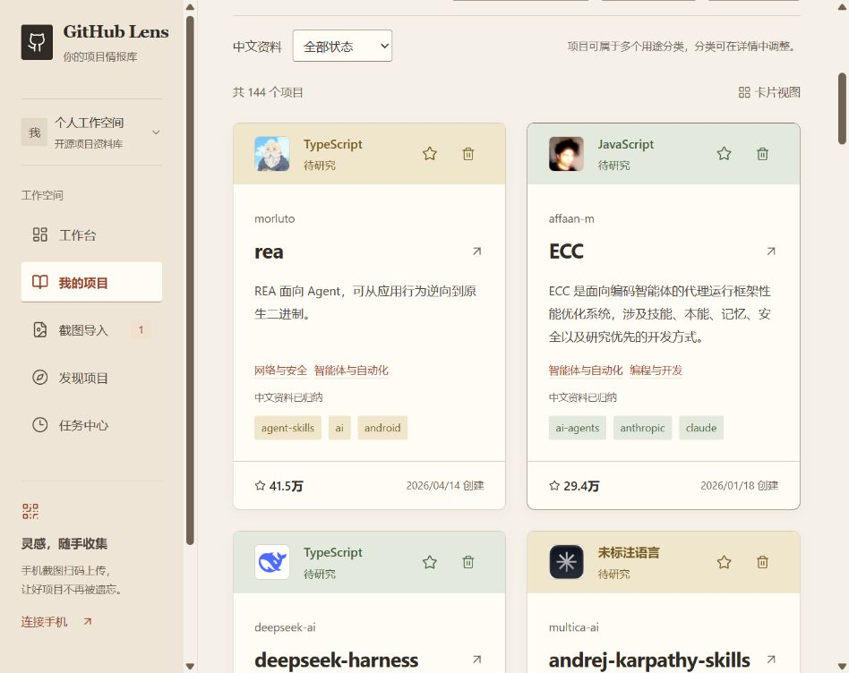
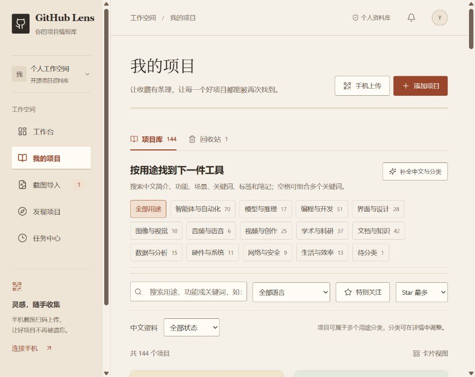
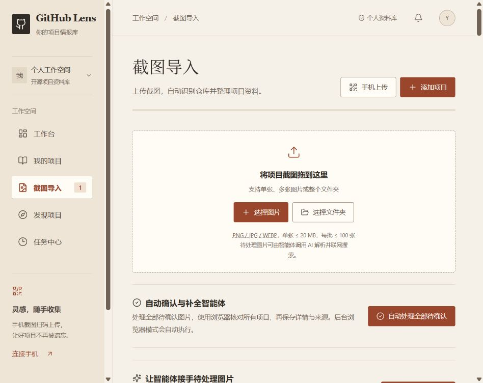
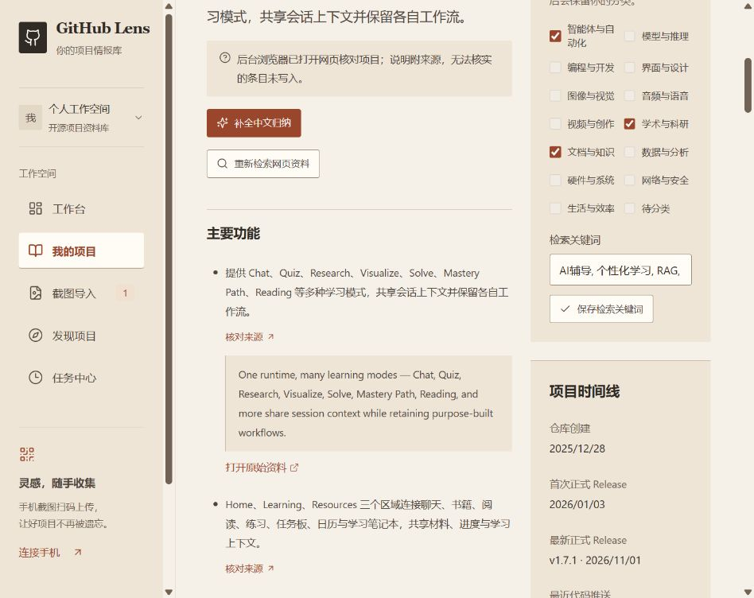

# GitHub Lens · 项目情报库

从截图建立可追溯的 GitHub 项目档案。支持桌面单图、多图和目录上传、PaddleOCR 本地识别、手机扫码上传，以及定时发现近期创建的高 Star 项目。

## 界面预览

暖白纸感界面，将截图线索整理成可搜索、可分类、可追溯的项目资料库。以下为实际运行界面，展示公开 GitHub 项目的资料；项目数据和统计会随使用变化。点击图片可查看大图。

**项目资料库**：用不同色调的项目卡片区分条目，集中展示中文简介、用途、标签与 Star，支持关注和回收站。



| 用途分类与搜索 | 截图导入与自动处理 |
| --- | --- |
| 按用途、语言、中文归纳状态和关键词筛选，快速找到适合当前任务的工具。 | 支持单图、多图、文件夹与手机上传，自动识别、核对和关联项目。 |
|  |  |

**中文详情与来源核对**：按主要功能、特色、场景等整理资料，每条说明可展开原文引用并跳转来源；右侧可调整用途分类和检索关键词。



## 快速启动（Windows）

需要 Python 3.12 与 Node.js 22+。可选安装 uv 加速 Python 环境管理。

```powershell
git clone https://github.com/yunmi02/github-lens.git
cd github-lens
.\scripts\setup.ps1 -WithOcr
.\scripts\start.ps1
```

打开 [本地工作空间](http://localhost:8000)，首次访问设置至少 10 位管理员密码。启动脚本默认监听局域网；只允许本机访问时使用 `start.ps1 -LocalOnly`。首次设置应从服务器本机进行；对外提供服务前也可以在 `.env` 预设 `ADMIN_PASSWORD`。

如果暂时不安装 OCR，可以先执行 `setup.ps1`，通过“添加项目”直接输入 GitHub 地址，或对已上传截图手动关联仓库。该模式不会伪造识别结果。

建议使用 Python 3.12 的独立 `.venv` 环境，不要依赖系统中不兼容的旧版 Python。

## 配置

复制 `.env.example` 为 `.env`。普通 OCR 在本机完成。默认研究方式是 `browser`：随服务启动的常驻执行器使用 Playwright 打开独立 Chrome，搜索和读取真实 GitHub 网页，自动领取队列任务。DeepSeek 负责图片理解和带引用的中文归纳，不调用搜索 API；GitHub Token 用于读取已核实仓库的元数据。需要本机已安装 Google Chrome、Python Playwright 和可用的 AI 配置。

这是项目自己的浏览器自动化服务，不是 Codex computer-use 桌面插件，也不接管你现有的 Chrome 窗口或登录信息。若明确选择 `computer_use`，仍需要授权桌面会话领取；`deepseek` 保留为显式选择的旧搜索 API 模式。

| 配置项 | 含义 |
| --- | --- |
| `GITHUB_TOKEN` | 可选 GitHub 凭证，只需读取公开资料的权限 |
| `OCR_PROVIDER=paddle` | 使用 PaddleOCR 3.x `predict()` 接口 |
| `OCR_LANG=ch` | 中英文截图默认识别语言 |
| `PUBLIC_BASE_URL` | 手机可访问的 `http://局域网IP:8000` 或公网 HTTPS 域名 |
| `AI_BASE_URL` | 兼容服务的基础地址，通常包含 `/v1` |
| `AI_API_KEY` / `AI_MODEL` | 中文摘要所需服务密钥与模型 |
| `AI_DAILY_LIMIT` | 每日最多 AI 摘要请求次数，默认 100 |
| `RESEARCH_BACKEND` | 默认 `browser`；`computer_use` 为桌面会话模式，`deepseek` 为旧搜索 API 模式 |
| `BROWSER_SERVICE_ENABLED` | 默认 `true`，随单 Worker 服务启动常驻浏览器执行器 |
| `BROWSER_CHANNEL` | 默认 `chrome`，使用本机已安装的 Google Chrome |
| `BROWSER_HEADLESS` | 默认 `true`，独立无界面浏览器；调试时可设 `false` |
| `BROWSER_REQUEST_INTERVAL_SECONDS` | 浏览器页面导航间隔，默认 15 秒，整个队列共用 |
| `BROWSER_SEARCH_INTERVAL_SECONDS` | 搜索页面导航后的间隔，默认 30 秒 |
| `BROWSER_COOLDOWN_SECONDS` | 网页 403/429 后全队列初始冷却，默认 900 秒，遵守更长的 Retry-After |
| `BROWSER_MAX_COOLDOWN_SECONDS` | 重复限流时指数退避的上限，默认 21,600 秒；网站要求更长时仍遵守 |
| `COMPUTER_USE_LEASE_SECONDS` | 浏览器任务认领租约，默认 900 秒；会话可续期 |
| `WORKER_ENABLED` / `SCHEDULE_ENABLED` | 后台任务处理与每日高星项目发现的开关 |
| `AGENT_AUTO_RESEARCH` | 默认 `true`；新图片 OCR 后自动进入配置的研究流程 |
| `AGENT_AUTO_CONFIRM` | 默认 `true`；研究后自动确认全部有效项目并搜索补全，设 `false` 恢复手动确认 |
| `AGENT_SEARCH_DAILY_LIMIT` | 仅旧 `deepseek` 模式的每日搜索 API 请求上限，默认 50 |
| `AI_SEARCH_BASE_URL` | 仅旧 `deepseek` 模式的可选搜索代理根地址 |
| `COOKIE_SECURE` | 公网 HTTPS 部署设为 `true` |
| `DATABASE_URL` | 本地默认 SQLite；支持 PostgreSQL SQLAlchemy URL |

请以供应商账单为准管理 Token 和费用；当前限制为每日请求次数上限。修改环境配置后重启服务。密码哈希首次写入数据库；后续修改 `ADMIN_PASSWORD` 不会覆盖已存在密码。

修改登录密码请使用“偏好设置 → 账号安全”，验证当前密码后设置至少 10 位的新密码。修改后当前会话继续可用，其他设备的旧登录失效。上传在解析文件前验证身份，整个请求有实际字节数上限；扫码链接并发领取时只允许一个请求成功。

GitHub Token 也可通过“偏好设置 → 配置 GitHub Token”配置。点击页面中的创建链接，在 GitHub 生成 Fine-grained Token，保持公开仓库只读访问即可；复制到系统的密码输入框，点击“验证并保存 Token”。系统使用 GitHub API 验证后写入服务器 `.env` 并立即生效，不回显令牌。验证失败不会覆盖旧配置；因 GitHub 额度受限而等待的任务会提前恢复。

## 使用流程

1. 点击“截图导入”，选择图片或桌面目录；单张不超过 20 MB，每批最多 100 张。
2. 系统提取 OCR 文本并派发浏览器研究任务；常驻服务自动搜索和核对项目、整理来源及详情。默认自动关联全部有效项目，关闭自动确认后可手动关联。
3. 在“任务中心”查看识别和资料补全进度；失败任务可重试。无匹配结果时可在截图详情填写正确链接。
4. 在“我的项目”按用途分类筛选，搜索中文简介、功能、场景、中英文关键词、标签和笔记，空格组合多个关键词。详情显示中文归纳、引用、README、Release、官方链接和来源截图。
5. 在“偏好设置”修改发现规则，在“发现项目”立即运行，或保持系统运行等待每日调度。

### 中文资料与用途分类

“补全中文与分类”会安排持久化的资料整理智能体，基于已保存的 README、仓库简介和浏览器来源补全中文概述、功能、场景及要求，再整理主要用途与中英文检索关键词。已完成的中文条目会复用，单项失败不阻断其他项目；新入库项目在 AI 配置可用时自动进入整理流程。此阶段不重新搜索网页，仍受模型日额度限制。

项目最多属于 3 个用途，可按学术与科研、文档与知识、视频与创作、编程与开发等分类筛选，并结合语言、关注和中文归纳状态检索。详情中可手动修改分类和关键词，自动整理保留你的选择。英文原始简介保存在“官方资料与来源”，不会冒充中文总结；来源不足会明确显示待补，特色未知时不编造。实现与开发说明见 [架构文档](docs/architecture.md)。

### 待处理项目研究智能体

默认流程：上传图片 → 本地 OCR → 模型提取全部线索 → 常驻 Chrome 自动搜索及核对 → 生成带原文引用的中文详情 → GitHub 元数据读取 → 全部有效项目关联 → 详情展示。

导入页支持“自动处理全部待确认”，单张图片支持“自动确认全部项目并补全”；自动模式没有单图项目数量和批量图片 20 张的截断。保留的手动研究入口每批最多 20 张。相同任务复用，已经关联的截图不会因其他未选候选继续出现在待确认列表。

任务中心显示浏览器服务的在线状态、当前步骤和实际浏览器执行次数。任务有独占租约、续期、超时回队、重复提交保护及取消入口；服务异常会重连，临时网络错误退避重试，AI 日额度耗尽后保存进度等待恢复。遇到网站验证会停止并显示原因，不绕过验证。运行说明见 [浏览器研究说明](docs/browser-research.md)。

网页出现 HTTP 429/403 时暂停整个浏览器队列，并显示预计恢复时间；不会换下一项继续访问同一网站。冷却与请求间隔持久化，重启服务不重置；冷却不消耗项目失败次数。已读取的网页和搜索结果链接保存后可继续使用。明确且经浏览器验证的仓库链接覆盖全部项目时，跳过重复搜索词；这不限制单图项目数量。

仅在 `RESEARCH_BACKEND=computer_use` 时，需要复制页面执行指令交给授权 Codex 桌面会话，协议见 [computer-use-agent.md](docs/computer-use-agent.md)。该手动模式不提供常驻桌面插件执行器。

浏览器负责项目检索与来源核对；GitHub API 负责读取已核实仓库的 README、Star、许可证和 Release。每条归纳校验原文引用，未知日期留空。原有 README 已存在但摘要失败的项目会展示官方原文摘录，并提供浏览器补全入口。这些摘录不是中文 AI 分析，特色也不代表独立创新性判断。

`browser` 与 `computer_use` 均不调用 DeepSeek Search。默认浏览器模式会将截图、OCR 线索和浏览器读到的正文发送给配置的模型进行解析和归纳，受 `AI_DAILY_LIMIT` 限制。选择 `deepseek` 才启用原有 `/v1/tools/search`。普通的手动资料收集任务仍可能调用已配置模型归纳 README。

“发现项目”的定时高星筛选是独立模块，仍使用 GitHub API 查询，遵循偏好设置中的规则。它与截图研究的浏览器检索不是同一条队列流程。

PaddleOCR 首次运行需下载检测和识别模型，时间取决于网络。长截图按重叠区块处理，并保留识别文字区域。CPU 本地识别会使用内存和计算资源。

## 手机扫码

电脑端点击“手机上传”，填写手机可访问的地址，再生成二维码。手机无需登录管理员账号，可在临时会话内上传图片、查看本批次回执；不具有读取历史资料库权限。

- 同一 Wi-Fi：例如 `http://192.168.1.100:8000`，电脑服务需要允许该端口入站。`localhost` 代表手机本身，无法指向电脑。
- 不同网络：部署到手机可访问的 HTTPS 域名，再设置 `PUBLIC_BASE_URL`。
- 二维码为单次领取，10 分钟内可用；领取后上传凭证可用 30 分钟，最多 100 张/500 MB，可在电脑撤销。
- 手机刷新可恢复本次会话和最近批次；不要把临时上传链接分享给无关人员。

## 信息口径

- 创建时间来自仓库 `created_at`；首次和最新正式 Release 按公开、非草稿、非预发布版本的 `published_at` 计算，缺失时明确提示。
- 当前首次 Release 计算最多检查 1,000 个发布版本；未遍历完整时，不宣称已找到首次发布时间。
- “特色与创新点”仅是有引用的资料归纳或作者声明，未经过独立新颖性评估。
- 中文摘要会校验每条引用是否逐字存在于原始资料；缺少引用的生成条目会被丢弃。此校验不等于对模型全部语义判断的保证。
- 无 AI 服务时展示真实官方原文和缺失状态。项目资料刷新保留个人备注、标签和收藏。
- 新项目榜默认近 30 天创建、至少 100 Star；首版每次最多采集 100 项，并显示查询条件、匹配总数和不完整标志。
- 项目 Star 快照已落库；完整观察池维护、7 日涨星榜和趋势图仍在后续范围内。

## 开发与验证

```powershell
# 服务端（从项目根目录）
.\.venv\Scripts\python.exe -m uvicorn app.main:app --app-dir backend --host 127.0.0.1 --port 8000

# 前端开发（另一个终端）
cd frontend
npm run dev

# 后端单元与集成测试
cd ..
.\.venv\Scripts\python.exe -m pytest backend/tests -q --import-mode=importlib

# 前端类型检查与生产构建
cd frontend
npm run build
```

后端测试已通过根目录 `pytest.ini` 配置导入路径。前端开发端口通过 Vite 代理 `/api`；手机联调推荐使用已构建的 8000 端口统一入口。

交互测试使用 Playwright，具体运行配置见 `frontend/playwright.config.ts`。测试使用独立数据库和测试密码，不改变真实工作空间。

安全与数据边界见 [安全说明](docs/security.md)，技术结构及后续范围见 [架构文档](docs/architecture.md)。

```powershell
cd frontend
npx playwright test
# 可选：真实浏览器上传 -> 本地 OCR -> GitHub -> 项目详情
$env:REAL_NETWORK='true'
npx playwright test real-pipeline.spec.ts
Remove-Item Env:REAL_NETWORK
cd ..
# 可选：需要联网，真实 OCR + GitHub 的上传到入库验证，使用临时数据库
.\.venv\Scripts\python.exe scripts/smoke_pipeline.py
# 可选：使用配置好的 DeepSeek，对合成截图验证真实图片理解、搜索及项目研究
.\.venv\Scripts\python.exe scripts/smoke_research.py
```

浏览器测试默认使用已安装的 Google Chrome；其他环境可调整 Playwright 的 `channel` 并安装对应浏览器。真实 OCR 测试素材为程序生成的清晰文字图片，不能替代对用户真实手机截图的准确率评估。

## Docker 与 PostgreSQL

在 `.env` 增加强密码 `POSTGRES_PASSWORD`，并预设管理员密码，然后：

```sh
docker compose up --build -d
```

此路径包含 OCR 依赖与 PostgreSQL。当前镜像未预装 Chrome 及 Playwright 浏览器系统依赖；使用默认 `browser` 模式前需在镜像中补齐，或显式选择其他研究后端。此次常驻浏览器验证环境为 Windows 本机，不代表 Docker 浏览器路径已验证。模型在首次识别时下载，挂载到独立模型卷。公网部署需自行配置域名和 HTTPS 反向代理；代理应限制请求体和请求速率，保留真实客户端边界。

应用使用单 Worker 的数据库任务队列；当前必须保持 Uvicorn `--workers 1`。队列持久化、退避重试和中断恢复已实现，多 Worker/横向扩容需要引入可靠的任务认领机制或迁移到 Celery/Redis。

## 数据、备份与恢复

- 默认数据库：`data/github-lens.db`；原图：`data/images/`。原图和 OCR 文字目前持续保留，可从导入中心按批次删除；自动保留期清理尚未启用。
- SQLite：先停止服务，再备份整个 `data` 目录；恢复时停止服务，将备份放回相同路径，然后启动。数据中包含登录密钥，应按私有文件保存。
- PostgreSQL：使用 `pg_dump` 备份数据库，同时备份图片卷；恢复使用 `pg_restore` 或相应 SQL 恢复方式。恢复前先验证目标数据库版本和备份格式。
- 导出的 JSON 用于项目资料迁移阅读，不包含图片与登录信息，不能代替完整系统备份。
- 数据库首版使用 SQLAlchemy `create_all` 初始化。后续表结构升级必须增加正式迁移，不应将 `create_all` 当作已有数据库升级工具。

## 目录

```text
backend/app/        API、鉴权、数据库、GitHub、OCR、摘要、持久化任务
backend/tests/      权限、上传、日期、去重、重试等测试
frontend/src/       React/TypeScript 工作台与手机页面
frontend/e2e/       浏览器交互测试
scripts/           Windows 环境安装与启动
docs/              架构、浏览器研究、安全和项目计划
```

参考：[PaddleOCR 仓库](https://github.com/PaddlePaddle/PaddleOCR)、[PaddleOCR 快速开始](https://www.paddleocr.ai/latest/en/quick_start.html)、[GitHub API](https://docs.github.com/en/rest)。

## 发布与许可证

仓库仅包含源码、测试、示例配置和开发文档；运行时会创建独立的空资料库。实际密钥、原图、数据库、备份和个人运行记录不包含在源码中。

当前尚未指定开源许可证，后续确定后补充 LICENSE。
