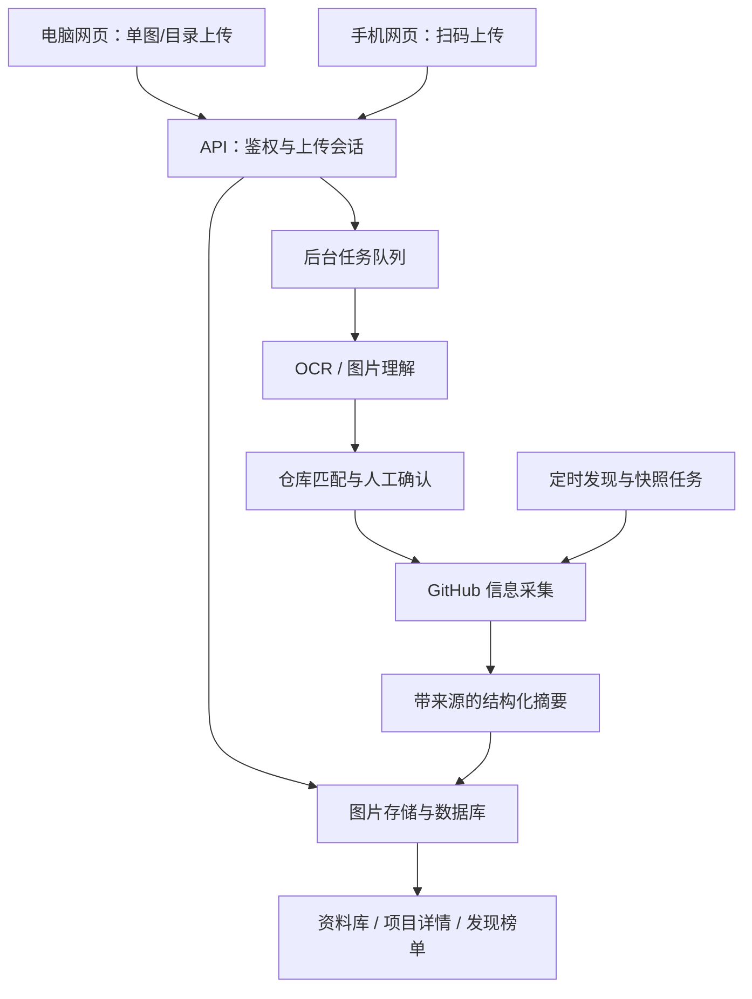

# GitHub 截图识别与项目情报管理系统：项目计划书

版本：V1.0 ｜ 编制日期：2026-10-28 ｜ 状态：开发规划稿

## 1. 项目概述

将手机和电脑中分散的 GitHub 项目截图，转换为可检索、可追溯、可持续更新的项目资料库；结合定时发现功能，主动收集近期创建且达到指定 Star 门槛的项目，并逐步提供涨星趋势。

核心闭环：**上传截图 → 提取项目线索 → 确认 GitHub 仓库 → 补全官方信息 → 生成中文项目档案 → 收藏、筛选与持续更新。**

首期按“个人使用、公开 GitHub 仓库、中文界面、响应式网页、允许配置外部 AI 服务”设计。所有阈值和容量均为建议初值，实施时应由样本测试校准，不代表已验证性能。本文只规划项目，不包含已实现的软件。

## 2. 用户场景与目标

| 场景 | 用户操作 | 预期结果 |
| --- | --- | --- |
| 单张截图整理 | 上传一张项目介绍或 GitHub 页面截图 | 自动定位项目并生成资料卡 |
| 历史截图清理 | 选择一个包含子目录的图片文件夹 | 批量识别、显示进度、合并重复项目 |
| 手机即时收集 | 扫描电脑页面二维码，选择手机图片 | 图片进入当前资料库，电脑自动更新任务状态 |
| 主动发现项目 | 设置时间范围、Star 门槛和领域 | 定时生成新项目列表，可加入收藏 |
| 评估是否值得使用 | 查看项目详情和原始资料 | 理解主要功能、特色、使用门槛及链接 |
| 后续回看 | 按标签、技术语言、收藏状态搜索 | 快速找到以前看到的项目及截图 |

## 3. 范围和优先级

### 3.1 首期必须交付（P0）

- 单图、多图、桌面文件夹上传；手机相册多选上传。
- OCR 与图片理解、项目候选识别、手动纠错、多项目截图拆分。
- GitHub 仓库真实性校验、基础信息与 README、Release 信息获取。
- 中文详细档案：主要功能、特色/创新点、时间信息、相关链接、来源。
- 项目列表、详情、搜索、标签、收藏、截图与项目去重。
- 手机扫码临时上传会话及电脑端任务状态同步。
- 自动获取“近期创建且达到 Star 门槛”的项目，提供定时任务设置。
- 任务队列、部分失败重试、限流处理、基础登录与数据备份。

### 3.2 第二阶段（P1）

- Star 历史快照、观察池涨星榜与趋势图。
- 项目笔记、已读/待研究/已使用状态、批量管理。
- Markdown、JSON、CSV 导出，项目信息变更对比。
- 手动输入 GitHub 链接导入；关注项目的新版本提醒。

### 3.3 后续扩展（P2）

- 相似项目对比、语义搜索、个性化推荐、日报与周报。
- PWA 分享入口、浏览器扩展、桌面目录监控。
- 团队共享、多人权限、私有仓库接入。

首期不开发原生手机 App，不自动安装或执行识别到的项目，不把 Star 数直接解释为质量或安全保证。网页选择文件夹仅导入当次选择的文件；持续监控本地目录属于后续桌面能力。

## 4. 功能详细设计

### 4.1 图片输入与批次管理

输入格式优先支持 PNG、JPEG、WebP；HEIC 作为兼容性增强，在具备解码与测试条件后开放。支持拖拽、文件选择、文件夹选择、失败项重新提交。

建议单张上限 20 MB、单批 100 张、累计 500 MB，限制需可配置；同时设置解码后像素上限。长截图按内容分块并保留重叠区域，合并识别结果；避免仅缩小整图导致文字不可读。

上传前展示缩略图、数量与大小；非图片明确列出为跳过项。每张图片独立处理，一张失败不阻塞其他图片。显示已完成、待确认、无项目、失败、跳过数量与原因。

浏览器目录选择可使用 `webkitdirectory`，获取目录层级文件；旧设备应回退到多文件选择。手机端以相册多选为主要路径，不承诺各手机浏览器都支持文件夹选择。[MDN 目录选择文档](https://developer.mozilla.org/en-US/docs/Web/API/HTMLInputElement/webkitdirectory)

### 4.2 识别与仓库定位

1. 校验文件类型、尺寸和哈希，生成缩略图，做必要的旋转、裁剪或切块。
2. OCR 提取中英文文本、URL、作者名、项目名和关键描述，保留文本位置。
3. 优先解析截图中的完整 GitHub 仓库链接；无链接时提取 `owner/repo`；线索不足时搜索候选仓库。
4. 使用 GitHub 返回的仓库信息核对名称、作者、简介、技术关键词，防止同名误匹配。
5. 无法唯一定位时展示最多 3—5 个候选和匹配理由，支持用户粘贴正确链接或标记无关图片。
6. 对已确认仓库获取资料并生成档案；不确定候选不得作为已确认收藏自动入库。

匹配证据强度分为“完整链接且校验成功”“名称/作者/内容一致”“只有名称或零散关键词”。证据等级由规则与测试样本校准，不能直接采用模型自报的置信分数。

一图可识别多个项目，多图也可关联同一项目。批量合并必须保留每张来源截图。仓库使用 GitHub 稳定 ID 去重，路径重命名或转移后更新链接。截图 Star 数仅作为截图历史内容保留，当前 Star 数以最新抓取值为准。

### 4.3 项目详情字段

| 字段组 | 展示内容 | 主要来源/规则 |
| --- | --- | --- |
| 基础信息 | 名称、owner/repo、中文一句话简介、原文简介 | 仓库 API、README |
| 主要功能 | 3—8 条功能、解决的问题、典型使用场景 | README/官方文档，有证据才填写 |
| 特色/创新点 | 设计特点、不同于常见实现的地方、作者声明 | 明确区分作者声明与 AI 归纳 |
| 技术信息 | 主要语言、Topics、部署方式、依赖、运行要求 | API、README；缺失显示未说明 |
| 社区与维护 | Star、Fork、开放 Issue、归档状态、最近推送时间 | API，展示采集时间 |
| 时间信息 | 仓库创建、首次正式 Release、最新正式 Release、截图上传时间 | 分字段展示，规则见下 |
| 相关链接 | GitHub、官网、文档、演示、Release、许可证文件 | API/README 中实际存在的链接 |
| 个人管理 | 标签、收藏、备注、研究状态 | 用户输入 |
| 可追溯信息 | 原截图、OCR 文本、引用段落、生成与刷新时间 | 原文件和采集记录 |

“创新点”不等同于经过同行验证的新颖性结论。无可靠依据时显示“尚无充分资料说明”；涉及优于某项目、首创或性能提升的说法，必须提供对应比较材料，否则仅记录为作者声明。摘要以中文为主，保留项目名与必要技术术语。

### 4.4 发布日期的定义

- **仓库创建时间**：GitHub `created_at`，不是软件首次公开发布日。
- **首次正式 Release 发布时间**：遍历公开 Release，排除草稿与预发布版本，取最早 `published_at`；如果遍历不完整，标记“首次发布时间尚未核实”。
- **最新正式 Release 发布时间**：同一规则下取最新 `published_at`，同时展示版本号。
- **最近代码推送时间**：使用 `pushed_at`，与 Release 发布时间分别展示。
- **无 Release**：显示“未发现正式 Release”，不能用仓库创建时间、Tag 日期或文章日期冒充。

GitHub Release 与普通 Git Tag 不是相同数据；发布日期按上述业务规则计算，不依赖版本名字符串排序。[GitHub Release API](https://docs.github.com/en/rest/releases/releases)

数据库时间统一保存 UTC，界面默认显示 Asia/Shanghai，并标明时区。

### 4.5 自动发现最新高星项目

将“最新高星”拆成可解释的榜单，避免混淆历史总 Star 与近期增长：

| 榜单 | 建议默认条件 | 排序 | 阶段 |
| --- | --- | --- | --- |
| 新项目榜 | 近 30 天创建、Star ≥ 100、非归档、非 Fork | 总 Star 降序 | P0 |
| 活跃高星榜 | Star ≥ 1,000、近 30 天推送 | 总 Star 降序 | P1 |
| 观察池涨星榜 | 已纳入观察池，具有有效历史快照 | 7 天净增 Star 降序 | P1 |

支持调整最近 7/30/90 天、Star 门槛、语言、主题和排除关键词。首期每天北京时间 09:00 自动发现，支持手动刷新；默认最多保存每个规则的前 200 条候选，界面明确显示采集范围与时间，不宣传为 GitHub 全站完整排名。

查询模板：`created:>=YYYY-MM-DD stars:>=100 archived:false fork:false`，配合 `sort=stars&order=desc`。日期由服务端按当前日期动态生成。GitHub 支持创建时间、Star、语言等过滤条件。[GitHub 仓库搜索语法](https://docs.github.com/en/search-github/searching-on-github/searching-for-repositories)

GitHub 搜索单次查询最多返回 1,000 条结果，搜索还有独立限流。需要更广覆盖时按创建日期和 Star 区间拆分查询、去重，并检测 `incomplete_results`；发生截断时显示覆盖不足。[GitHub Search API](https://docs.github.com/en/rest/search/search)

涨星计算：`净增 Star = 本次 Star − 对应历史快照 Star`。记录真实采样间隔；不足 7 天显示“观察中”，缺失样本不得填零或伪造历史。Star 可以减少，应保留负值。初期观察池建议最多 1,000 个项目，每天采样一次，可根据 API 预算调整。

自动发现先保存轻量元数据，只对规则限定的 Top N 或用户打开/收藏的项目生成完整 AI 摘要。发现列表与个人收藏分开，避免自动抓取淹没个人资料库。

### 4.6 手机扫码上传

电脑点击“手机上传” → 服务端创建临时上传会话 → 展示二维码 → 手机浏览器打开上传页 → 选择多张照片 → 上传并接收批次回执 → 电脑通过 SSE 或轮询更新进度。

- 二维码包含随机、高熵、短时有效的上传令牌，建议 10 分钟内允许建立会话，可在电脑端立即撤销。
- 上传会话只允许向指定资料库上传和查看本次批次状态，不允许浏览历史图片、修改设置或读取 API 密钥。
- 会话限制总文件数、大小、请求速率；领取后绑定短时会话凭证。令牌过期阻止新上传，但已被服务端接收的任务继续处理。
- 原始二维码令牌在服务端保存哈希；进入手机页后交换为受限会话凭证，避免长期保留在地址栏、日志或外链 Referer 中。
- 手机端展示单文件进度和重试入口，刷新页面后可恢复查看已创建批次。

部署有两种路径：

| 模式 | 条件 | 适用场景 |
| --- | --- | --- |
| 同一局域网 | 电脑服务监听局域网网卡、开放对应端口、手机可达；二维码使用局域网 IP，不能用 localhost | 本地个人使用 |
| 公网 HTTPS | 服务部署到可从手机访问的域名，启用登录和受限上传会话 | 手机移动网络、随时收集 |

二维码只传递入口地址，不会自动打通网络。系统应有“手机连接说明”和失败诊断；需要跨网络上传时选择公网部署或由用户配置的安全隧道。

## 5. 页面与交互规划

| 页面 | 核心区域 | 关键操作 |
| --- | --- | --- |
| 概览 | 项目数、待确认数、最近收集、新项目推荐 | 上传、扫码、查看待办 |
| 导入中心 | 拖拽区、目录选择、手机二维码、批次列表 | 上传、取消未开始任务、重试 |
| 候选确认 | 原截图、提取线索、候选仓库对照 | 确认、手填链接、忽略 |
| 我的项目 | 搜索、筛选、卡片/表格、标签 | 收藏、排序、进入详情 |
| 项目详情 | 摘要、功能、特色、时间线、链接、来源与截图 | 打开 GitHub、纠错、刷新 |
| 发现页 | 榜单、规则、采集时间、覆盖说明 | 改筛选、收藏、手动刷新 |
| 设置 | GitHub 凭证、AI 服务、计划任务、存储与备份 | 测试连接、限额配置 |
| 手机上传页 | 会话有效性、图片选择、进度、回执 | 上传、重试 |

卡片优先展示名称、中文简介、主要语言、Star、明确标注类型的日期、收藏状态；详细功能与引用放在详情页。空数据、首次使用、识别中、需确认、API 限流、离线和任务失败均须有独立状态。

## 6. 技术架构建议

采用模块化单体应用加独立后台 Worker，避免首期拆分过多服务。以下是待技术验证的实现候选，不绑定某个 AI 厂商或具体依赖版本。

| 层次 | 建议方案 | 选择原因 |
| --- | --- | --- |
| 前端 | React + TypeScript + Vite，响应式组件库 | 同时覆盖电脑与手机上传页 |
| 服务端 | Python + FastAPI | 便于集成 OCR、图片处理和 AI 调用 |
| 后台任务 | Celery + Redis，单独调度进程 | 支持长任务、重试、限速与定时采集 |
| 数据库 | PostgreSQL | 支持关系数据、JSON 结构和后续检索 |
| 图片存储 | 首期本地持久化目录，预留对象存储接口 | 降低本地运行成本，便于迁移 |
| 文字识别 | 本地 OCR 适配器，候选 PaddleOCR | 常规图片优先低成本处理，先验证 Windows/容器兼容性 |
| 图片理解与摘要 | 可配置多模态/文本模型接口 | 复杂排版兜底和中文结构化总结 |
| 外部信息 | GitHub REST API | 仓库元数据、README、Release 与搜索 |
| 部署 | Docker Compose，公网场景增加 HTTPS 反向代理 | 统一依赖和数据卷，支持备份恢复 |

OCR 与多模态模型采用分级调用：清晰完整链接优先规则提取；复杂、模糊或线索不足图片再调用视觉模型；仓库正文摘要可使用文本模型。模型不可用时仍保留 OCR、候选、仓库基本信息并允许稍后补全。

## 7. 数据模型与接口草案

### 7.1 核心实体

| 实体 | 关键字段/约束 |
| --- | --- |
| users / libraries | 用户、资料库、归属关系；首期可仅一个用户 |
| upload_sessions | 令牌哈希、资料库、有效期、额度、撤销状态 |
| import_batches / images | 批次、存储路径、SHA-256、原文件名、状态、错误 |
| recognition_results | OCR 文本、区域、项目候选、证据等级、模型版本 |
| repositories | GitHub repo ID 唯一、owner/name、标准链接、语言、许可证、时间字段 |
| image_repository_links | 图片与仓库多对多关系、确认状态、确认人 |
| repository_sources | 来源 URL、采集时间、内容哈希、引用片段、README commit SHA |
| repository_summaries | 结构化内容、逐项来源、提示词/模型版本、生成状态 |
| library_projects | 资料库与仓库关联、收藏、标签、备注、用户修订 |
| repository_snapshots | 仓库 ID、采样时间、Star/Fork 等，建立联合索引 |
| discovery_rules / runs | 筛选条件、执行计划、游标、覆盖状态、最近成功时间 |
| tasks | 任务类型、阶段、重试数、幂等键、耗时、错误码 |

所有生成内容与人工修订分开保存；刷新官方信息不能覆盖用户备注和手工修正。相同图片哈希用于精确去重，近似截图去重只作提示。原图删除后应同步清理缩略图和相应可识别文本，并明确是否保留已收藏项目的公开资料。

### 7.2 主要接口

| 接口 | 用途 |
| --- | --- |
| `POST /api/import-batches` | 创建导入批次 |
| `POST /api/import-batches/{id}/images` | 上传图片，返回异步任务标识 |
| `GET /api/import-batches/{id}` | 查询进度和逐项结果 |
| `GET /api/import-batches/{id}/events` | SSE 推送进度，可回退轮询 |
| `POST /api/recognitions/{id}/confirm` | 确认仓库或提交手动链接 |
| `GET /api/projects` | 搜索、筛选和分页 |
| `GET /api/projects/{id}` | 获取项目详细档案 |
| `POST /api/projects/{id}/refresh` | 异步刷新官方资料和必要摘要 |
| `PATCH /api/projects/{id}` | 更新个人标签、备注、收藏 |
| `POST /api/upload-sessions` | 创建手机上传会话 |
| `POST /api/upload-sessions/exchange` | 交换二维码令牌为受限会话 |
| `DELETE /api/upload-sessions/{id}` | 撤销上传权限 |
| `GET /api/discoveries` | 获取榜单及采集范围说明 |
| `POST /api/discovery-rules` | 保存发现规则与执行计划 |

标准任务阶段：已接收 → 预处理 → 识别 → 匹配 → 待确认（如需）→ 信息采集 → 摘要生成 → 完成。允许部分完成、可重试失败、终止失败、用户取消；用户取消只影响未执行阶段，不删除已有收藏。

## 8. 可靠性、隐私与成本控制

1. **准确性**：摘要通过结构化 Schema 校验；功能、特色、链接等条目关联来源。无法核实则留空或标记待核实，不生成看似真实的 URL。
2. **外部内容隔离**：截图和 README 视为不可信资料，不能成为执行指令；不运行仓库代码。渲染 Markdown 时清理脚本、危险协议与原始 HTML。
3. **请求边界**：仓库获取优先允许 GitHub 官方接口；外链默认仅展示。若后续抓取官网，需防止访问内网地址和通过重定向绕过限制。
4. **上传安全**：后端校验实际 MIME 和解码内容，随机存储文件名，隔离存储目录，限制像素和文件数量；不直接把用户文件名作为磁盘路径。
5. **隐私**：手机上传前说明图片是否发往外部 AI；原图可配置保留 30 天或长期保留。原图、OCR 和来源截图应按同一删除策略处理；备份过期清除策略另行明确。
6. **凭证管理**：GitHub/AI 密钥只在服务端，优先采用部署 Secret 或环境变量；网页不回显完整密钥，日志不记录密钥或二维码原始令牌。
7. **限流与恢复**：按响应头、`Retry-After`、额度重置时间调度；暂时失败采用退避和抖动，建议最多 3 次重试。永久错误进入人工处理，批量任务可从已完成阶段继续。
8. **缓存和预算**：仓库资料建议缓存 24 小时，按内容哈希判断是否重新摘要；设置每日识别次数、Token 和费用上限，超额暂停 AI 补全并显示原因。
9. **备份**：数据库与图片同步纳入每日备份，建议保留 7 天每日备份及 4 周周备份；上线前执行一次恢复演练。

GitHub 当前文档列出未认证 REST 请求通常为每小时 60 次，常规用户认证为每小时 5,000 次，另有搜索与次级限制。实际运行必须读取接口响应额度，不能将某个固定数字当作所有场景的保证。[GitHub API 限流文档](https://docs.github.com/en/rest/using-the-rest-api/rate-limits-for-the-rest-api)

## 9. 验收标准

先建立至少 100 张经人工标注的截图集，覆盖：完整链接、仅名称、中英文、长图、模糊图、多项目图、重复图和无关图片。对存在歧义的图片允许多个合理候选或标注为无法确定，避免为了提高自动处理率强行匹配。

| 验收项 | 建议通过标准 |
| --- | --- |
| 清晰链接识别 | 清晰且包含完整 GitHub 仓库地址的测试子集，正确提取并匹配比例 ≥ 95% |
| 自动确认精确率 | 自动确认的结果中，正确仓库关联 ≥ 98%；同时报告自动覆盖率，防止全部转人工 |
| 歧义处理 | 无法唯一定位样本显示候选/待确认，无关图片不会强制生成仓库 |
| 批量上传 | 100 张规定大小内图片可提交，逐项状态可见，部分损坏不影响其他文件 |
| 多图与多项目 | 同仓库重复图合并档案，来源保留；一图多项目可分别确认 |
| 日期准确性 | 创建时间与 Release 时间分开；无 Release 和采集不完整均有明确说明 |
| 摘要可信度 | 人工抽查至少 30 份档案，核心事实均能追溯来源，未发现伪造链接 |
| 手机扫码 | iOS Safari、Android Chrome 真机验证；局域网和已配置公网模式均可完成上传 |
| 访问控制 | 过期/撤销令牌不能新建上传，手机会话不能读取历史资料库 |
| 自动发现 | 调度可自动执行，展示规则与更新时间；API 限流不会产生静默空榜 |
| 去重与重试 | 重复上传、重复投递任务不产生重复仓库记录，失败任务可恢复 |
| 页面与响应 | 建议在约定测试环境下 1 万条项目的分页列表 P95 ≤ 2 秒；测试不含外部采集耗时 |
| 性能观测 | 记录单图端到端耗时 P50/P95、各阶段失败率及费用；识别耗时以首轮实测建立基线 |
| 备份恢复 | 在干净部署中恢复数据库与图片，随机抽查可打开原图和项目档案 |

以上准确率与性能是待验证的验收目标，不是现有系统测量结果。涨星榜上线另验收观察不足 7 天、快照缺失、负增长与重复采样四类情况。

## 10. 开发里程碑与交付物

参考投入：1 名全栈开发者全职工作，用户提供截图样本并参与每周验收；预计 6—8 周交付首期。此为粗估，实际受 OCR 兼容性、AI 服务、网络和部署环境影响。

| 阶段 | 时间 | 工作与交付物 | 退出条件 |
| --- | --- | --- | --- |
| 需求与技术验证 | 第 1 周 | 样本集、线框图、OCR/模型对比、API 与扫码网络验证 | 选定识别路径、明确部署方式与成本基线 |
| 最小识别闭环 | 第 2—3 周 | 单图上传、候选确认、GitHub 补全、中文详情页 | 一张图片可完整生成可追溯档案 |
| 批量与手机输入 | 第 4 周 | 文件夹、多图、多项目、去重、任务中心、扫码上传 | 电脑和手机入口均跑通，失败可重试 |
| 资料库与自动发现 | 第 5 周 | 搜索收藏、标签、定时新项目榜、规则设置 | 数据可查可管理，发现任务自动运行 |
| 稳定性与交付 | 第 6 周 | 权限、限流、预算、备份、部署文档、验收报告 | 首期验收通过 |
| 风险缓冲 | 第 7—8 周 | 真机兼容、识别优化、外部服务与部署问题修复 | 关闭影响核心流程的问题 |

第二阶段另估 2—3 周：涨星快照与榜单、导出、笔记和更新提醒；历史增长数据需等待真实采样积累。

最终交付应包括：源代码、环境变量示例、数据库迁移、Docker Compose、API 文档、测试与验收报告、使用说明、备份恢复步骤。第一周即可开始保存 Star 快照，为后续趋势功能积累数据。

## 11. 成本估算方法与主要风险

月运行成本由服务部署、数据库/图片存储与备份、OCR 服务（如选云服务）、视觉模型调用、文本摘要调用组成。尚未选定供应商和部署规格，暂不编造固定月费。

估算方式：`月费用 ≈ 固定基础设施费 + 图片识别次数 × 实测单次识别费 + 新建/变更摘要次数 × 实测单次摘要费 + 存储/流量费`。文本模型按实际输入输出 Token 单价计算，图片模型按供应商的图片或 Token 计价规则计算。

第一周用 100 张代表性截图测量平均费用与 P95 费用，再按预计月上传量和自动发现摘要量外推。重复项目复用摘要、普通图片先 OCR、限制自动发现摘要数量，是主要节省措施。

| 风险 | 影响 | 应对 |
| --- | --- | --- |
| 截图模糊或只有宣传文案 | 找不到或匹配错误仓库 | 候选确认、手填链接、保留未识别项 |
| AI 将宣传语写成事实 | 档案误导 | 来源引用、区分作者声明、人工纠错 |
| GitHub 网络或额度不足 | 补全/榜单延迟 | 缓存、退避、任务恢复、显示旧数据时间 |
| 电脑与手机网络不通 | 扫码后打不开 | 连接诊断、明确局域网/公网部署前提 |
| 自动发现范围过大 | API 和 AI 成本增长 | 观察池/Top N 上限、分层采集、每日预算 |
| 项目转移、删除或归档 | 链接和档案过时 | 稳定 ID、定时校验、状态提示、保留历史 |
| 运行环境无法安装 OCR 依赖 | 开发排期延迟 | 首周验证容器路径，预留云端或视觉模型适配器 |

## 12. 开发前需要确认的配置

这些事项不阻塞本计划书落地，默认值供原型开发使用：

| 配置 | 原型默认值 | 后续选择影响 |
| --- | --- | --- |
| 使用规模 | 单人、公开仓库 | 多人/私有仓库会增加权限和授权设计 |
| 部署环境 | 本机或个人服务器；优先验证同一 Wi-Fi 上传 | 随时从移动网络上传需要公网 HTTPS 入口 |
| 图片量 | 按每批 100 张测试，月规模待确认 | 决定队列并发、存储及 AI 预算 |
| AI 服务 | 可配置外部服务，上传前说明数据流向 | 全离线要求会增加本地算力和模型部署工作 |
| 发现偏好 | 近 30 天、Star ≥ 100、不限语言 | 按实际关注领域调整推荐量与噪声 |
| 图片保留 | 默认 30 天，可长期保留 | 影响存储和删除策略 |
| 完整摘要范围 | 用户导入项目 + 自动发现每日前 20 个 | 影响模型费用和生成延迟 |

建议开发首先完成“截图 → 正确仓库 → 有来源的详情页”的纵向闭环，再接入批量上传、扫码和自动发现；以识别准确性、资料可追溯性与日常收集便利性作为首期成败标准。
